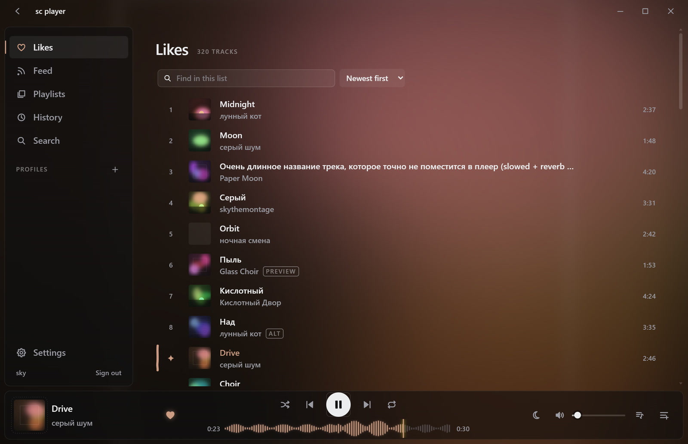
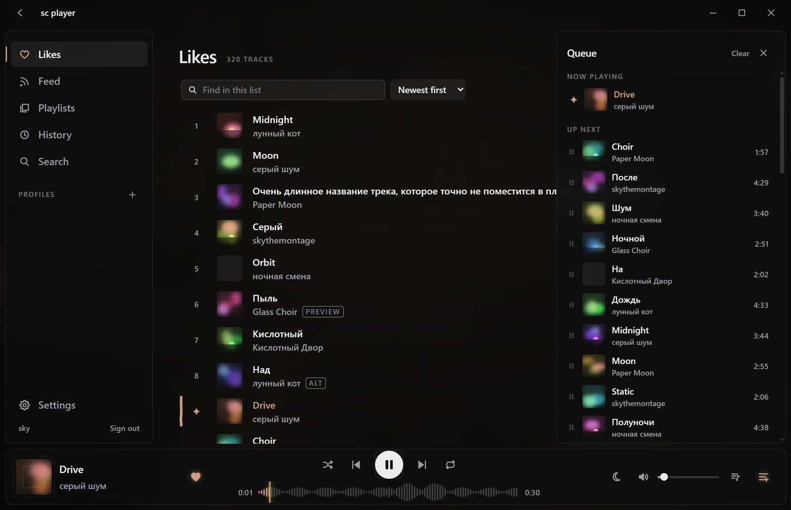
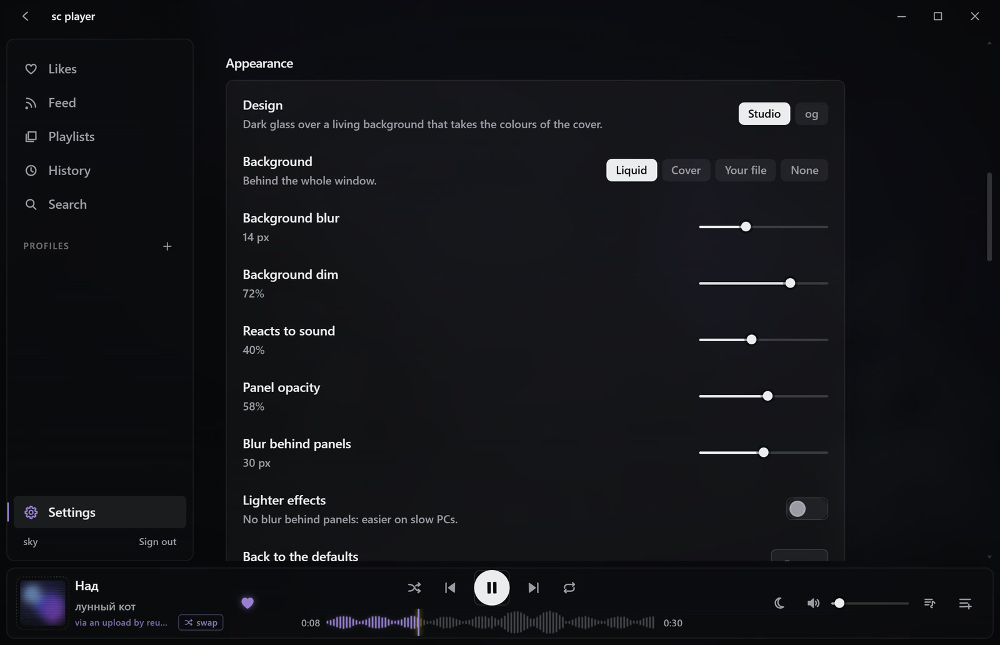
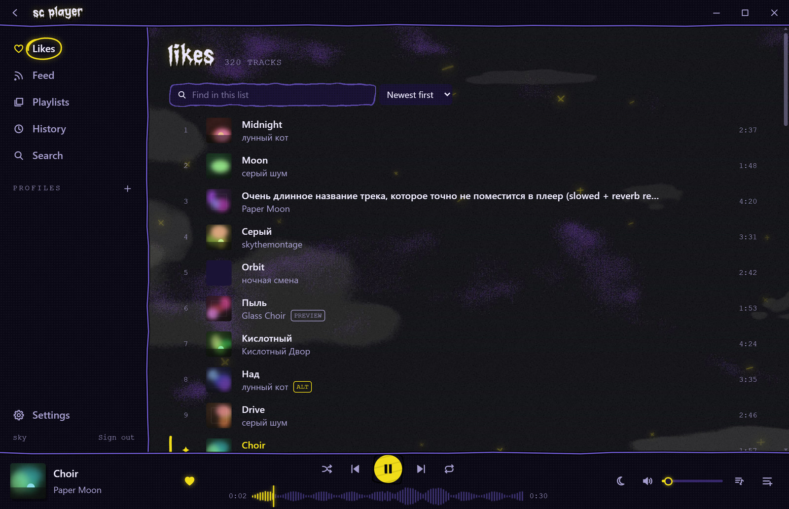

# sc player

**A SoundCloud player for Windows — no ads, a living background, and a shuffle that really shuffles.**

[Download](../../releases/latest) •
[Features](#features) •
[Install](#install) •
[Good to know](#good-to-know)

 

---

## Preview

  <table>
    <tr>
      <td align="center" width="50%">
        
         
        <b>Queue</b>
      </td>
      <td align="center" width="50%">
        
         
        <b>Make it yours</b>
      </td>
    </tr>
  </table>

> [!NOTE]
> sc player is an unofficial app, not affiliated with SoundCloud. It uses the same interface as soundcloud.com, so it
> needs SoundCloud to be reachable from your network.

---

## Features

**The look**
- **Studio design:** dark glass over a living background that takes the colours of the cover and drifts with the music.
  The accent follows every track; a thin spectrum lines the cover in the player.
- **Your background:** the liquid colours, the cover itself, your own image, GIF or video — or nothing.
- **Knobs** in Settings → Appearance: background blur, dim and how much it reacts to sound; panel opacity and the blur
  behind them; lighter effects for slow PCs.
- **og:** the hand-drawn night sky of 1.x is one click away — clouds in three layers, stars that twinkle with the
  hi-hats, a sky that takes the colour of the cover.

**Your library**
- Likes, playlists (yours and liked ones), albums, history, the feed of people you follow, any public profile.
- Find and sort inside likes, playlists and a profile's tracks. Pin profiles to the sidebar.
- ♥ the track that's playing, add it to one of your playlists from the right-click menu.

**Playback**
- **Honest shuffle:** the whole playlist or all your likes, not just the tracks that happened to load.
- **Autopilot:** when the list ends, similar tracks keep playing (can be turned off).
- **Protected tracks:** when SoundCloud only streams a track with DRM or as a 30-second preview, sc player looks for
  another upload of the same recording and plays that (marked `ALT`; "try another" if it's the wrong one).
- **Lyrics** from [Better Lyrics](https://betterlyrics.org) (often timed word by word), its community catalog Unison
  and [LRCLIB](https://lrclib.net); click a line to jump there. Words that come without timings can be matched to the
  song on your computer (Settings → Lyrics; an optional speech model, the sound never leaves your PC).
- Seek on the waveform, a queue you can drag, repeat, crossfade, a 10-band equalizer with presets, output device,
  sleep timer.

**Windows**
- Media keys, the system media overlay with the cover, ⏮ ⏯ ⏭ under the taskbar preview.
- Tray, global hotkeys, notifications, start with Windows, an optional track card in a corner of the screen.
- Updates itself: the app tells you about a new version and installs it.
- Nothing moves while the window is hidden — only the sound keeps going.

---

## Install

1. Download one file from the [latest release](../../releases/latest):
   - `sc-player-setup-v….exe` — the installer (shortcuts on the desktop and in the Start menu);
   - `sc-player-portable-v….exe` — runs without installing.
2. The app isn't code-signed, so Windows may say "Windows protected your PC": click **More info → Run anyway**.
3. Click **Sign in to SoundCloud** to see your likes and playlists. If the sign-in window says "access temporarily
   restricted" or "something unexpected happened", use **Sign in with your browser** instead. Without signing in you can
   open any public profile by pasting a `https://soundcloud.com/…` link.

New versions install over the old one; your sign-in and settings stay.

---

## Good to know

- Some tracks are only streamed encrypted (DRM — usually monetized and major-label releases). If no other upload of the
  same recording exists, the track is marked `PROTECTED` and skipped.
- If SoundCloud changes its site, the app shows an error with **Retry**; if that doesn't help, check for a
  [new version](../../releases/latest).
- When SoundCloud's bot protection stops a like or a playlist add, the app opens its check in a window — pass it once
  and try again.
- soundcloud.com is blocked in Russia. The community guide for getting it back with zapret:
  [«Как починить SoundCloud с помощью zapret»](https://github.com/Flowseal/zapret-discord-youtube/issues/7449)
  (by kkkwkswd). A proxy can also be set in Settings → Network.

---

## Thanks

- **[Better Lyrics](https://betterlyrics.org)** — sc player shows lyrics from Better Lyrics and from Unison, its
  community catalog, with the permission of its author. Many of them are timed word by word, so the words light up
  as they are sung. Thank you!
- **[LRCLIB](https://lrclib.net)** — the open lyrics database.
- **[Whisper](https://github.com/openai/whisper)** by OpenAI (MIT) — the speech model that matches plain lyrics to the
  song on your computer.
- The zapret guide for SoundCloud by kkkwkswd.

Prefer the night sky?

 

 
Settings → Appearance → Design → <b>og</b>.

---

made by sky (@skythemontage) · SoundCloud is a trademark of SoundCloud Ltd.

