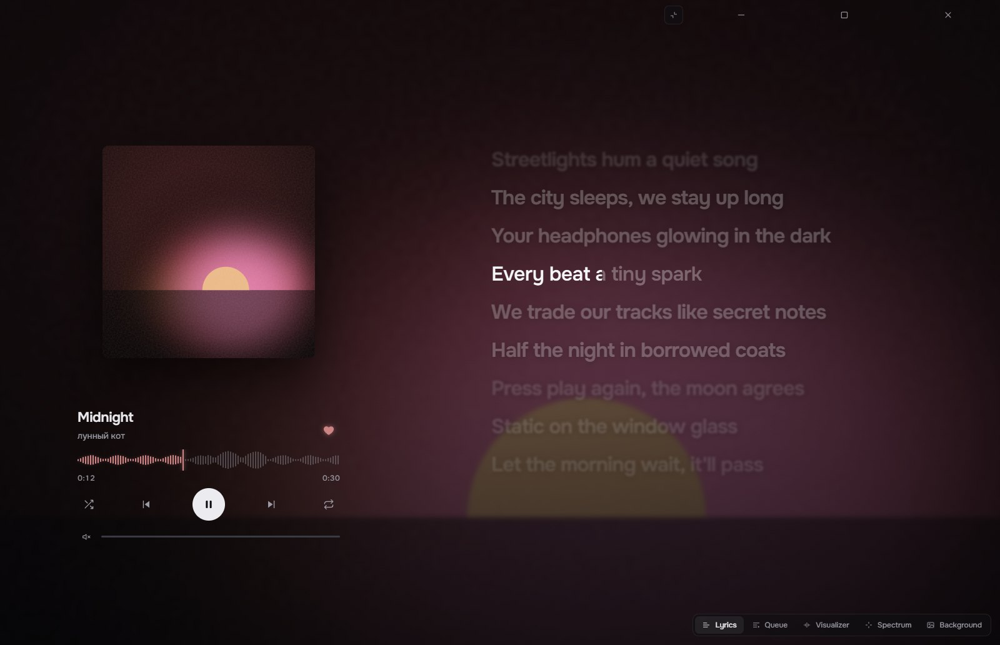
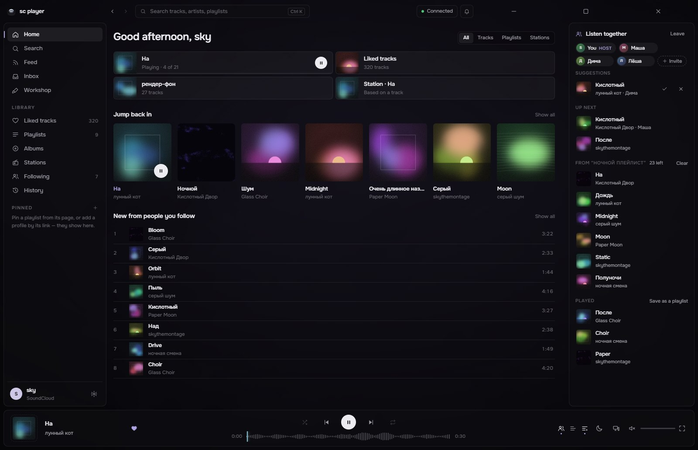

# sc player

**A SoundCloud player for Windows — no ads, lyrics word by word, and friends to listen with.**

[Download](../../releases/latest) •
[Features](#features) •
[Install](#install) •
[Good to know](#good-to-know)

 

---

## Preview

  <table>
    <tr>
      <td align="center" width="50%">
        
         
        <b>Lyrics, word by word</b>
      </td>
      <td align="center" width="50%">
        
         
        <b>Listen together</b>
      </td>
    </tr>
    <tr>
      <td align="center" colspan="2">
        
         
        <b>Make it yours</b>
      </td>
    </tr>
  </table>

> [!NOTE]
> sc player is an unofficial app, not affiliated with SoundCloud. It uses the same interface as soundcloud.com, so it
> needs SoundCloud to be reachable from your network.

---

## Features

**Together**
- **Listening rooms:** invite friends and everyone hears the same track at the same second. Pause is shared; the host
  puts on tracks or a whole playlist, the others suggest theirs; the host can hand the room over, and when the queue
  runs out similar tracks keep it going.
- **Send tracks to friends:** friend codes (no accounts), an Inbox, what your friends are listening to right now, and an
  invite link to send in any messenger.
- **On Home:** what your friends are playing and what people listen to on sc player (anonymous).

**Lyrics**
- From [Better Lyrics](https://betterlyrics.org) (often timed word by word), its community catalog Unison and
  [LRCLIB](https://lrclib.net); click a line to jump there.
- Words that come without timings can be matched to the song on your computer (Settings → Playback → Lyrics; an
  optional speech model, the sound never leaves your PC). Timings made for another upload are moved to fit this one.
- **Full screen player:** a big cover with a spectrum around it or along the bottom, and the words lighting up as
  they're sung.

**The look**
- Dark glass over a living background that takes the colours of the cover — or the cover itself, your own image, GIF
  or video.
- Your own interface colour and accent, blur, dim, panel opacity; lighter effects for slow PCs.
- **Workshop:** publish your look and install other people's.

**Your music**
- Likes, playlists, albums, stations, history, the feed of people you follow, any public profile; pin playlists and
  profiles to the sidebar.
- **Your own playlists:** make them, add to them, reorder, rename — kept on your computer, no sign-in needed; copy any
  SoundCloud playlist to change it, save the queue as one, export them to a file and back.
- **Honest shuffle** over the whole playlist or all your likes; **autopilot** keeps playing similar tracks.
- **Protected tracks:** when SoundCloud only streams a track with DRM or as a 30-second preview, sc player plays
  another upload of the same recording, checked by its sound (marked `ALT`).
- Seek on the waveform, a queue you can drag, crossfade, a 10-band equalizer, output device, sleep timer.

**Windows**
- Media keys, the system media overlay, ⏮ ⏯ ⏭ under the taskbar preview, tray, global hotkeys, notifications.
- Updates itself. Nothing moves while the window is hidden — only the sound keeps going.

---

## Install

1. Download one file from the [latest release](../../releases/latest):
   - `sc-player-setup-v….exe` — the installer (shortcuts on the desktop and in the Start menu);
   - `sc-player-portable-v….exe` — runs without installing.
2. The app isn't code-signed, so Windows may say "Windows protected your PC": click **More info → Run anyway**.
3. Click **Sign in to SoundCloud** to see your likes and playlists. If the sign-in window says "access temporarily
   restricted" or "something unexpected happened", use **Sign in with your browser** instead. Without signing in you can
   still search, listen, make playlists and open any public profile.

New versions install over the old one; your sign-in, settings and playlists stay.

---

## Good to know

- Some tracks are only streamed encrypted (DRM). If no other upload of the same recording exists, the track says
  `SoundCloud only` and opens on soundcloud.com.
- SoundCloud's bot protection doesn't let apps change playlists on SoundCloud, so the playlists you make here are kept
  on your computer (Export them now and then — they don't travel with your SoundCloud account).
- If SoundCloud changes its site, the app shows an error with **Retry**; if that doesn't help, check for a
  [new version](../../releases/latest). Something broken? Settings → Account → **Report a problem**.
- Settings → Network: **Automatic** uses your own connection, and sc player's own route to SoundCloud only when
  SoundCloud doesn't open over it. The community guide for SoundCloud in Russia with zapret:
  [«Как починить SoundCloud с помощью zapret»](https://github.com/Flowseal/zapret-discord-youtube/issues/7449)
  (by kkkwkswd).

---

## Thanks

- **[Better Lyrics](https://betterlyrics.org)** — sc player shows lyrics from Better Lyrics and from Unison, its
  community catalog, with the permission of its author. Many of them are timed word by word, so the words light up
  as they are sung. Thank you!
- **[LRCLIB](https://lrclib.net)** — the open lyrics database.
- **[Whisper](https://github.com/openai/whisper)** by OpenAI (MIT) — the speech model that matches plain lyrics to the
  song on your computer.
- The zapret guide for SoundCloud by kkkwkswd.

---

made by sky (@skythemontage) · SoundCloud is a trademark of SoundCloud Ltd.

